
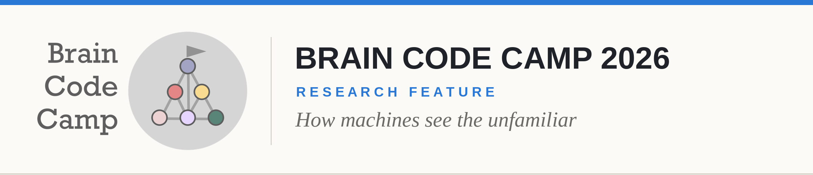

# On the Architectural Dependency of First-Encounter Out-of-Distribution Recognition Failures in Deep Neural Networks

**By Jirakitt Chojaimeesuk** · Brain Code Camp 2026 · November 2026

*Two families of AI vision models can be equally accurate and still get things wrong in completely different ways. A student experiment traces those differences back to how each model is built, and to what it learned to rely on.*

---

## A hyena at the zoo

**W**hen I was a kid, my brother and I stood in front of a hyena at the zoo and argued about what it was. I said it looked like a dog. He was sure it looked like a cat. It was neither, of course. We had never seen a hyena before, so each of us reached for the closest thing we already knew.

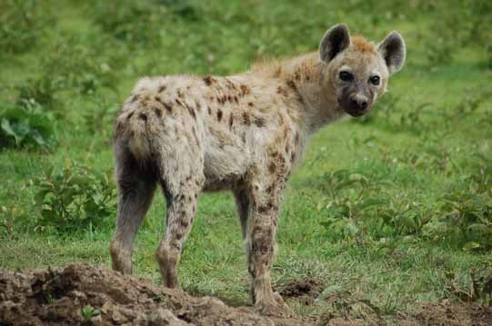

<em>A spotted hyena. To a child who has never seen one, it looks like a dog, or a cat, depending on who you ask. Image: ImageNet sample set.</em>

That argument stayed with me, because it hides two questions. Why do we map something new onto something familiar? And why do two people, looking at the same animal, map it onto different things?

Artificial intelligence has the same problem. An image classifier trained on ten categories has no way to say "I have never seen this before." Show it a hyena and it must answer dog, cat, or one of its other eight labels. It will be wrong. The interesting part is *how* it is wrong, and whether a different kind of model would be wrong in the same way.

## Two machines, two ways of seeing

I picked two kinds of model that are built very differently, to stand in for my brother and me.

**The convolutional neural network (CNN)** works like a magnifying glass. It scans a small patch of the image, slides along, and builds up the big picture layer by layer from textures, edges and lines. I used ResNet-18 [2], a standard CNN.

**The Vision Transformer (ViT)** works more like a jigsaw puzzle. It cuts the image into 64 small tiles and, from the very first layer, asks how every tile relates to every other tile. It sees the whole scene at once [3].

Both designs can classify images well. But their insides are different, and a 2020 study by Golan and colleagues on "controversial stimuli" [1] gave me a way to look at that difference: compare models not by how often they are right, but by the images they disagree on.

That led to my research question. When a CNN and a ViT give different answers to an image they have never seen, is that difference really caused by their architecture? I tested two hypotheses:

1. When the models answer differently, the difference comes from their architecture, not from chance or from one model simply being better.
2. Even when they give the same answer, what happens inside them is still different.

## Setting a fair trap

The experiment was designed so that architecture is the only thing that differs between the models. Everything else was held fixed.

**Same lessons.** Every model learned from the same 50,000 images of CIFAR-10 [4], a dataset of ten everyday categories: airplane, car, bird, cat, deer, dog, frog, horse, ship and truck. Each trained for 100 epochs with identical settings (AdamW [12], learning rate 0.001, warmup then cosine decay, the same RandAugment data augmentation [13]).

**Same exam.** Every model was then shown the same 10,000 images from CIFAR-100: wolves, lions, plates and dozens of other things that are not among the ten categories. No answer is correct, so every answer is a mistake. The question is which mistake.

**Similar size.** The three models are close in size, so no one wins by sheer capacity.

| | CNN (ResNet-18) | ViT | Hybrid |
| --- | --- | --- | --- |
| How it sees | Convolutions, patch by patch | 64 tiles of 4×4 pixels | Convolutional first layer, then a transformer |
| Parameters | 11.2 million | 8.3 million | 9.2 million |
| Accuracy on CIFAR-10 | ~95% | ~88% | ~91% |

The hybrid model is a ViT whose first layer is swapped for a convolution. It sits between the two families and helps show which part of the architecture matters.

**Seven runs of each.** Training has randomness in it, set by a number called the seed. Two models of the same type trained with different seeds will not behave identically. So I trained each type seven times. Seeds 0 to 4 were used for the analysis. Seeds 5 and 6 were locked away and only used at the end, to check whether the findings held up on models that had never been looked at.

Why seeds and not k-fold cross-validation? K-fold measures accuracy by giving each model a different slice of training data. Here the training data is a controlled variable: every model must learn from exactly the same images and be tested on exactly the same images, or their mistakes cannot be compared one to one. Changing only the seed isolates the randomness of training itself.

**Measuring agreement.** To compare two models' mistakes, I used Cohen's kappa [5]. It measures how often two models pick the same wrong answer, after removing the agreement you would expect by chance. A kappa of 0 means they agree no more than chance; 1 means they pick the same answer on every image.

## Finding 1: They really are wrong in different ways

Models of the same family make the same mistakes. Models of different families do not. Two CNNs agree on their wrong answers with a kappa of 0.53 to 0.59, and two ViTs do the same. But a CNN and a ViT agree with a kappa of only 0.34.

| Within a family | Between CNN and ViT | Permutation test |
| :---: | :---: | :---: |
| **0.53–0.59** | **0.34** | **p = 0.008** |

Think of a multiple-choice exam that nobody can pass. Students from the same class tend to pick the same wrong option, because they were taught the same way. Students from a different class pick a different wrong option.

> ### *"Students from the same class pick the same wrong option. Students from a different class pick a different one."*

A gap like this could still be a fluke, so I tested it with a permutation test [14]. I shuffled the CNN and ViT labels across all ten models in every possible way, 252 arrangements, and recomputed the gap each time. Only 2 of the 252 arrangements produced a gap as large as the real one, giving p = 0.008. That is the smallest p-value this design can produce.

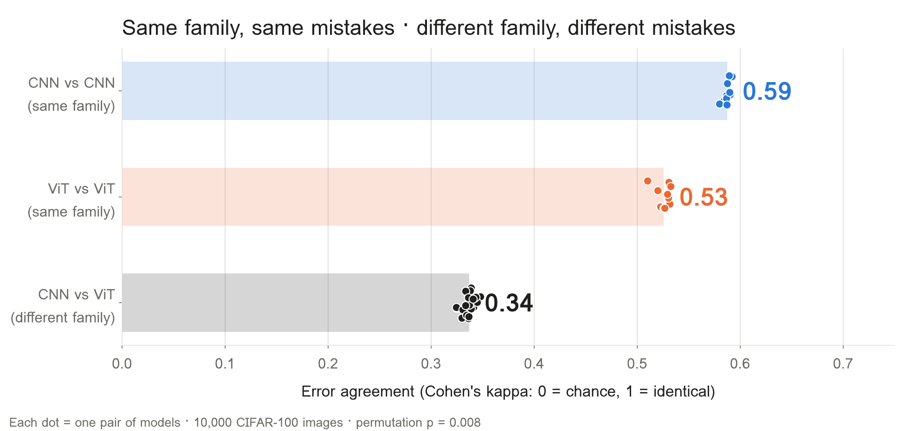

*Figure 1. How often two models choose the same wrong answer. Each dot is one pair of models; longer bars mean more shared mistakes. CNN–ViT pairs sit far below same-family pairs.*

### Three objections, checked

I expected three objections, and tested each one.

1. **"The CNN is just more accurate."** I took a CNN checkpoint from partway through training, when it was 88% accurate, the same as the ViT. Cross-family agreement was still only 0.32, against 0.48 to 0.53 within a family. Accuracy is not the explanation.
2. **"It's a coincidence."** I repeated the analysis on the locked-away models from seeds 5 and 6. Cross-family agreement was 0.34 again, against 0.51 to 0.59 within a family. The result replicates.
3. **"They were different before training."** Untrained models with random weights agree with each other at a kappa of about 0.03, which is almost nothing. The pattern is learned during training.

### The images they fight over

I then looked for *controversial* images: ones where all five CNNs give one answer and all five ViTs unanimously give another. There were 257 of them. Their character is striking. On these images, ViTs most often answer **frog** (59 images), while CNNs most often answer **dog** (51 images).

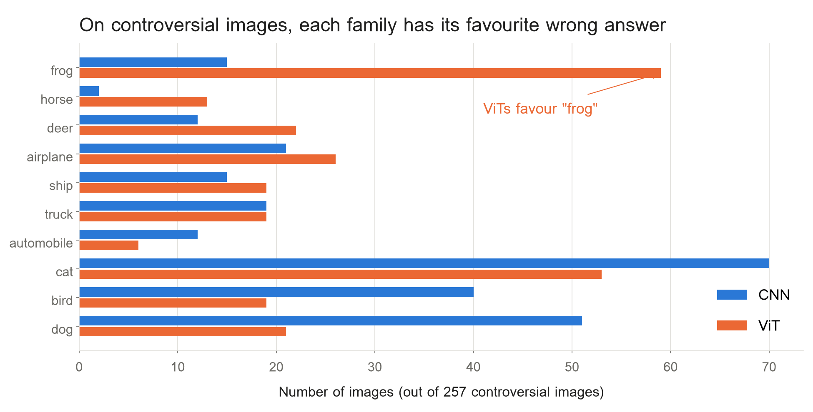

*Figure 2. On the 257 controversial images, each family has a favourite wrong answer: frog for ViTs, dog for CNNs.*

Because I chose these images using seeds 0 to 4, testing them on the same models would flatter the result. So I showed them to the unseen models from seeds 5 and 6. Those models still split along family lines on 135 of the 257 images. By chance alone, about 38 would.

## Finding 2: Same eyes, different interpretation

CNNs and ViTs see an image in much the same way at first, then part ways as they get closer to a decision. On the images they disagree about, internal similarity falls from 0.86 in the first layer to 0.38 in the last.

| First layer | | Last layer |
| :---: | :---: | :---: |
| **0.86** | → | **0.38** |

To look inside the models, I used linear CKA (centered kernel alignment, from Kornblith and colleagues, 2019 [6]). CKA compares the internal representations of two networks layer by layer, on a scale from 0 (nothing in common) to 1 (identical). I ran it on 2,000 images across 25 CNN–ViT pairs, matching each layer to its most similar counterpart in the other model.

The early layers of both models handle colours, edges and simple shapes, and there they look alike. The split happens deep in the network, where those features are turned into a judgement. It is like two people looking at the same photograph: they see the same colours and lines, but conclude it shows two different things.

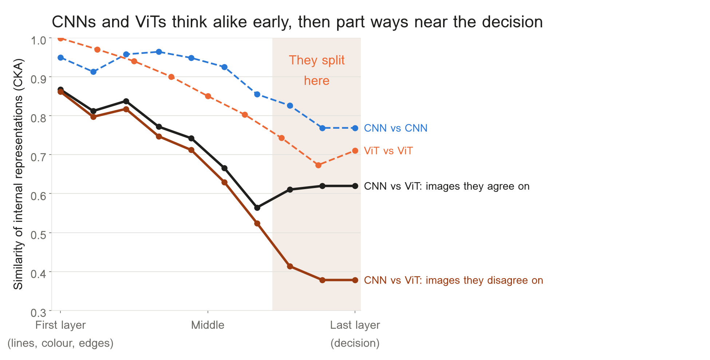

*Figure 3. Similarity of internal representations from the first layer (left) to the last (right). Dashed lines compare models of the same family. The CNN–ViT line drops sharply near the decision, most of all on images they disagree about.*

This also supports my second hypothesis. Even when the final answers match, what happens inside the deeper layers is not the same.

### Where they look

A second tool, Integrated Gradients [11], shows which pixels a model relied on for its answer, as a kind of heat map. When they answer wrongly, two models of the same family look at similar parts of the image (similarity 0.61 to 0.64). A CNN and a ViT agree only 0.47. Like two witnesses describing the same scene, they point to different evidence.

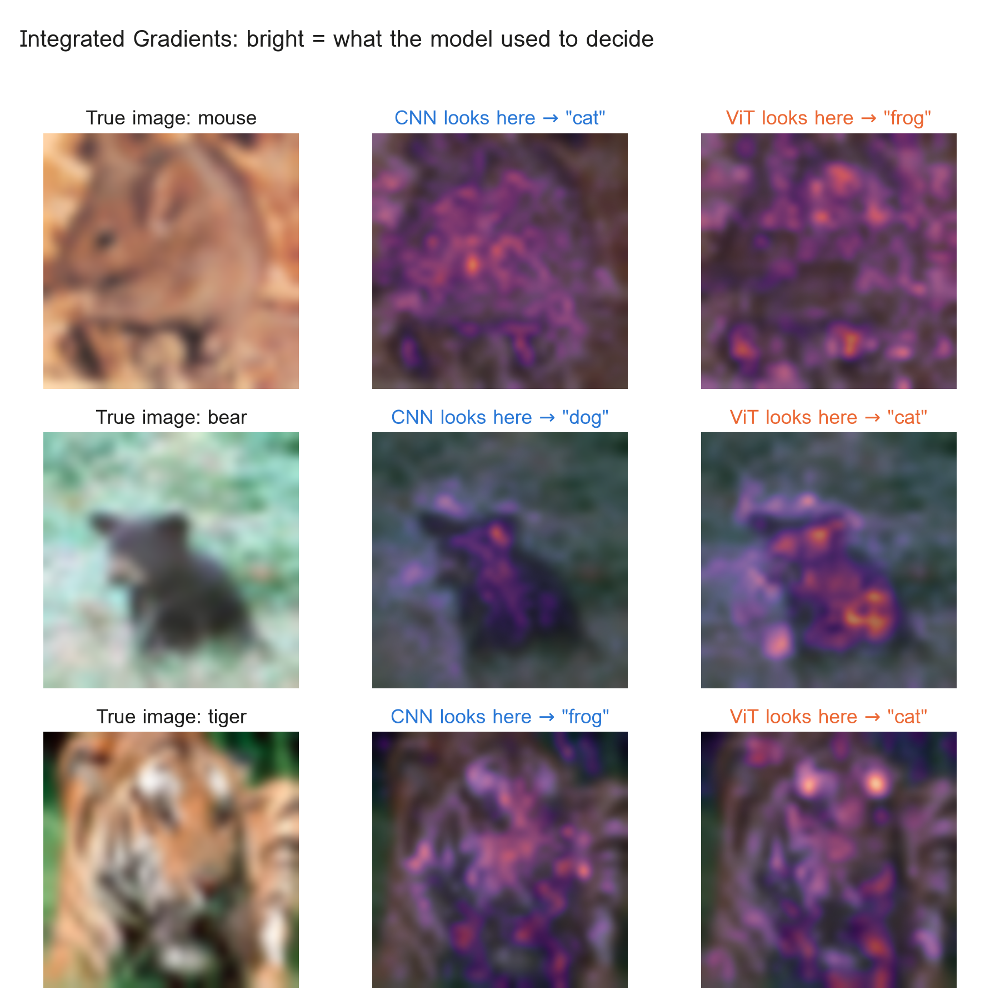

*Figure 4. Where each model looked when it answered wrongly. Bright areas are the pixels that drove the answer.*

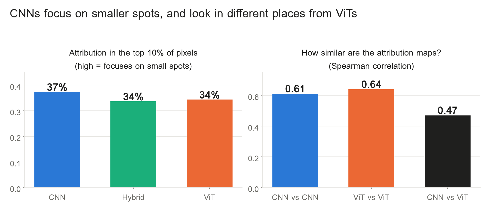

*Figure 5. Left: CNNs concentrate on smaller spots. Right: attribution maps agree within a family far more than across families.*

## Finding 3: Take away the crutch, and the quirk disappears

CNNs lean on fine detail; ViTs lean on colour and the overall shape. When I removed the thing each model relies on, its family-specific mistakes largely vanished. This is the strongest evidence in the study, because it tests cause rather than correlation.

The idea is simple: take off one pair of glasses at a time and see who can no longer see. I altered the test images in four ways.

1. **Grayscale** removes colour.
2. **High-pass filtering** removes the overall shape and keeps only fine texture.
3. **Blur** does the opposite: it removes fine texture and keeps the overall shape.
4. **Patch shuffling** cuts the image into an 8×8 grid and scrambles the pieces, destroying global shape while keeping each piece intact.

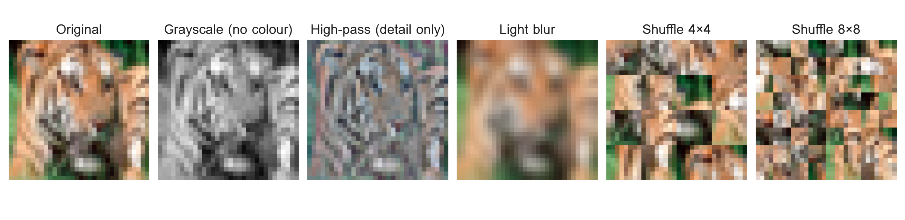

*Figure 6. One test image under each alteration.*

For each alteration I measured two things: how accurate each family stayed, and how much of its **model-specific error** survived. Model-specific error is how much more a model's mistakes resemble its own family's than the other family's (within-family kappa minus cross-family kappa). I divided it by the same value on normal images, so 100% means the family's quirk is fully intact and 0% means it is gone. Dividing matters: every model gets worse on altered images, so accuracy alone cannot tell you whether the quirk survived.

| Alteration | CNN accuracy | ViT accuracy | CNN quirk left | ViT quirk left |
| --- | --- | --- | --- | --- |
| Grayscale (no colour) | 89% | 72% | 81% | **21%** |
| High-pass (detail only) | 89% | 64% | 65% | **8%** |
| Blur (shape only) | 49% | 61% | **20%** | 45% |
| Patch shuffle 8×8 | 21% | 48% | — | — |

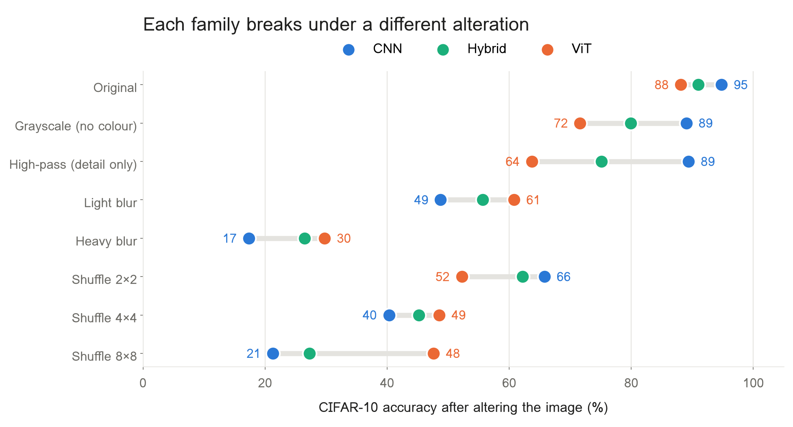

*Figure 7. Accuracy after each alteration. Compare the dots row by row: each family breaks under a different change.*

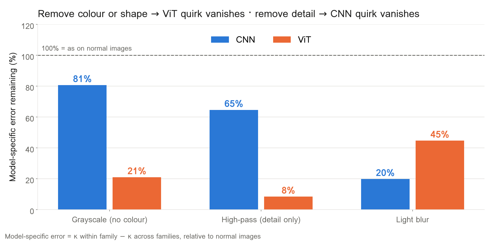

*Figure 8. How much of each family's quirk survives. Removing colour or shape erases the ViT's; blurring erases the CNN's. These two experiments currently use two models per family.*

The pattern is a clean mirror image. Remove colour or global shape, and the ViT loses its quirk while the CNN barely notices. Blur away the fine detail, and it is the CNN that loses its quirk. Scramble the pieces, and the CNN collapses to 21% accuracy while the ViT holds at 48%. The hybrid model, a ViT with a convolutional first layer, collapses like a CNN (27%), suggesting that the very first layer is part of the story.

### Solving the frog mystery

Remember that ViTs love to answer "frog"? On normal images, ViTs call 15% of the unfamiliar pictures a frog. In grayscale, that drops to 6%, the same as CNNs. On the controversial images, it falls from 16% to 5%.

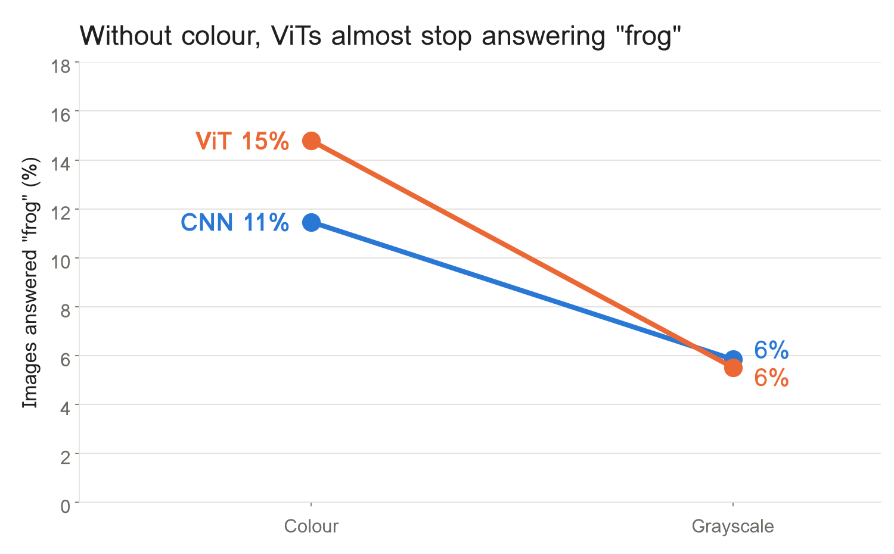

*Figure 9. Share of images answered "frog", in colour (left) and grayscale (right). The steeper the line, the more a model relied on colour.*

The ViT had learned frogs as *a green blob*. Take away the green, and it stops seeing frogs everywhere. It is exactly the hyena problem: a model meets something new and reaches for the familiar feature it trusts most.

> ### *"The ViT had learned frogs as a green blob. Take away the green, and it stops seeing frogs everywhere."*

## Finding 4: Architecture matters, but it is not the whole story

About 9% of the 10,000 unfamiliar images are mistaken in a way that clearly depends on model type. Another 22% fool every model in the same way, and 32% produce answers that look random.

I sorted every image by the pattern of its mistakes, like a teacher sorting the questions a whole school got wrong:

- **Wrong by class (9%).** Models of the same type pick the same answer at least 80% of the time, but agree with the other type no more than 20% of the time. This is architecture leaving a clear fingerprint.
- **Wrong together (22%).** Every model, CNN or ViT, makes the same mistake. Something in the image itself, or in the training data, points everyone the same way.
- **Wrong at random (32%).** Even models of the same type agree less than half the time. Here the random seed decides the answer more than the architecture does.

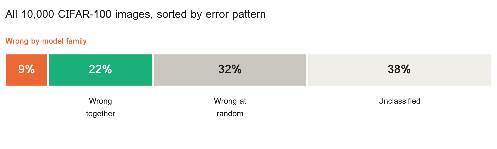

*Figure 10. All 10,000 test images, sorted by the pattern of their mistakes.*

The rest fall between these groups. The lesson is humbling: the randomness of training has a large effect, and the sharpest architectural differences live in a minority of images. That is exactly why the controls in Finding 1 mattered.

To separate whether the "wrong together" images come from the training data or from the images themselves, I am now training a further set of models on the other half of the data.

## What this study cannot yet say

The findings are consistent across every check, but the study is small and has clear limits.

1. **Tiny images.** CIFAR images are only 32×32 pixels. Models may behave differently on full-size photographs.
2. **Some overlap in categories.** A few CIFAR-100 classes resemble CIFAR-10 ones, such as pickup trucks and trucks.
3. **ViTs are data-hungry.** On a small dataset, ViTs end up less accurate than CNNs. That is why the 88%-accuracy CNN check was needed.
4. **Fewer models in places.** The image-alteration and attribution experiments currently use two models per family. They are being rerun with all five.
5. **Averaged similarity.** The CKA analysis averages over the whole image, which may make early layers look more similar than they are.
6. **Small models, trained from scratch.** The results apply to small models trained for this study and cannot yet be generalised to large pretrained ones.

Next steps are to rerun stages 2 and 3 with five models per family, finish the second-half-of-data models, and test whether the pattern holds on larger images and pretrained models.

## Why a model's mistakes matter

A model's mistakes reveal what it relies on more clearly than its successes do. Two models can score the same and still carry very different habits, and those habits only show when they meet something new.

This study fits a wider picture. Earlier work found that ImageNet-trained CNNs rely heavily on texture [8], that ViTs are more robust to scrambled patches [9], and that the two families build their internal representations differently [10]. Measuring *which* errors models share, rather than how many, has also been proposed as a sharper way to compare models with each other and with people [7].

The practical consequences are real. If you combine models into an ensemble, two that fail differently cover each other's blind spots better than two that fail the same way. In safety-critical settings, knowing that a model leans on colour, or on texture, tells you which conditions will catch it out.

My brother and I were both wrong about the hyena. But we were wrong in different ways, and those differences said something true about how each of us had learned to see. The same turns out to hold for machines.

> ### *"We were wrong in different ways, and those differences said something true about how each of us had learned to see."*

■

---

## References

1. Golan, T., Raju, P. C., & Kriegeskorte, N. (2020). Controversial stimuli: Pitting neural networks against each other as models of human cognition. *Proceedings of the National Academy of Sciences*, 117(47), 29330–29337. [doi:10.1073/pnas.1912334117](https://doi.org/10.1073/pnas.1912334117) · [free full text](https://pmc.ncbi.nlm.nih.gov/articles/PMC7703564)
2. He, K., Zhang, X., Ren, S., & Sun, J. (2016). Deep residual learning for image recognition. *IEEE Conference on Computer Vision and Pattern Recognition (CVPR)*, 770–778. [arXiv:1512.03385](https://arxiv.org/abs/1512.03385)
3. Dosovitskiy, A., Beyer, L., Kolesnikov, A., et al. (2021). An image is worth 16×16 words: Transformers for image recognition at scale. *International Conference on Learning Representations (ICLR)*. [arXiv:2010.11929](https://arxiv.org/abs/2010.11929)
4. Krizhevsky, A. (2009). *Learning multiple layers of features from tiny images* (Technical report). University of Toronto. [CIFAR-10 and CIFAR-100 datasets](https://www.cs.toronto.edu/~kriz/cifar.html)
5. Cohen, J. (1960). A coefficient of agreement for nominal scales. *Educational and Psychological Measurement*, 20(1), 37–46. [doi:10.1177/001316446002000104](https://doi.org/10.1177/001316446002000104)
6. Kornblith, S., Norouzi, M., Lee, H., & Hinton, G. (2019). Similarity of neural network representations revisited. *International Conference on Machine Learning (ICML)*, 3519–3529. [arXiv:1905.00414](https://arxiv.org/abs/1905.00414)
7. Geirhos, R., Meding, K., & Wichmann, F. A. (2020). Beyond accuracy: Quantifying trial-by-trial behaviour of CNNs and humans by measuring error consistency. *Advances in Neural Information Processing Systems (NeurIPS)*, 33. [arXiv:2006.16736](https://arxiv.org/abs/2006.16736)
8. Geirhos, R., Rubisch, P., Michaelis, C., Bethge, M., Wichmann, F. A., & Brendel, W. (2019). ImageNet-trained CNNs are biased towards texture; increasing shape bias improves accuracy and robustness. *International Conference on Learning Representations (ICLR)*. [arXiv:1811.12231](https://arxiv.org/abs/1811.12231)
9. Naseer, M., Ranasinghe, K., Khan, S., Hayat, M., Khan, F. S., & Yang, M.-H. (2021). Intriguing properties of vision transformers. *Advances in Neural Information Processing Systems (NeurIPS)*, 34. [arXiv:2105.10497](https://arxiv.org/abs/2105.10497)
10. Raghu, M., Unterthiner, T., Kornblith, S., Zhang, C., & Dosovitskiy, A. (2021). Do vision transformers see like convolutional neural networks? *Advances in Neural Information Processing Systems (NeurIPS)*, 34. [arXiv:2108.08810](https://arxiv.org/abs/2108.08810)
11. Sundararajan, M., Taly, A., & Yan, Q. (2017). Axiomatic attribution for deep networks (Integrated Gradients). *International Conference on Machine Learning (ICML)*, 3319–3328. [arXiv:1703.01365](https://arxiv.org/abs/1703.01365)
12. Loshchilov, I., & Hutter, F. (2019). Decoupled weight decay regularization (AdamW). *International Conference on Learning Representations (ICLR)*. [arXiv:1711.05101](https://arxiv.org/abs/1711.05101)
13. Cubuk, E. D., Zoph, B., Shlens, J., & Le, Q. V. (2020). RandAugment: Practical automated data augmentation with a reduced search space. *CVPR Workshops*, 702–703. [arXiv:1909.13719](https://arxiv.org/abs/1909.13719)
14. Good, P. I. (2005). *Permutation, Parametric, and Bootstrap Tests of Hypotheses* (3rd ed.). Springer. [doi:10.1007/b138696](https://doi.org/10.1007/b138696)
